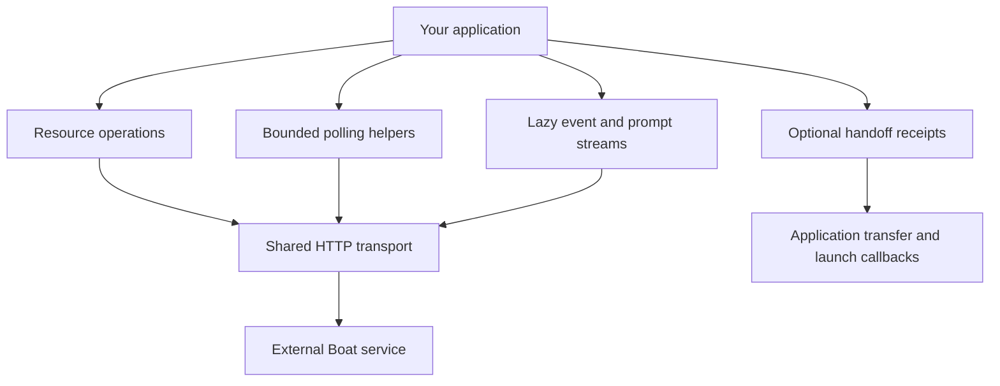

Use this library to call Boat from Rust while keeping remote effects separate from local observation.

For example, your application can create a sandbox, wait until it is usable, run a command, then request deletion and track the deletion operation. A timed-out request does not prove a mutation failed, and a sandbox disappearing from a list does not prove cleanup completed. This client builds and decodes requests; the remote Boat service owns compute, storage and resource policy.

## Choose your next decision

- [Configure credentials and organization scope](configuration.md) before sending requests.
- [Decide whether a failed HTTP request can retry](http-retries.md).
- [Wait for readiness or confirmed deletion](waits.md), without treating a cancelled wait as remote rollback.
- [Consume event pages and prompt completion](streams.md) without ending before final events are drained.
- [Run commands and move files](commands-files.md), including unsupported synchronous streaming.
- [Find lifecycle, snapshot, environment and account operations](resources.md).
- [Resume application-managed handoff safely](handoff.md) after a callback or receipt-write failure.
- [Inspect the complete feature inventory](inventory.md) and [current verification](verification.md).

The public `BoatApi`/`BoatClientConfig` names are aliases of `Api`/`ClientConfig`. This is a standalone library, not a user interface or an implementation of the Boat backend. The inventory covers its pinned 59-operation surface; it does not promise newer upstream endpoints.
