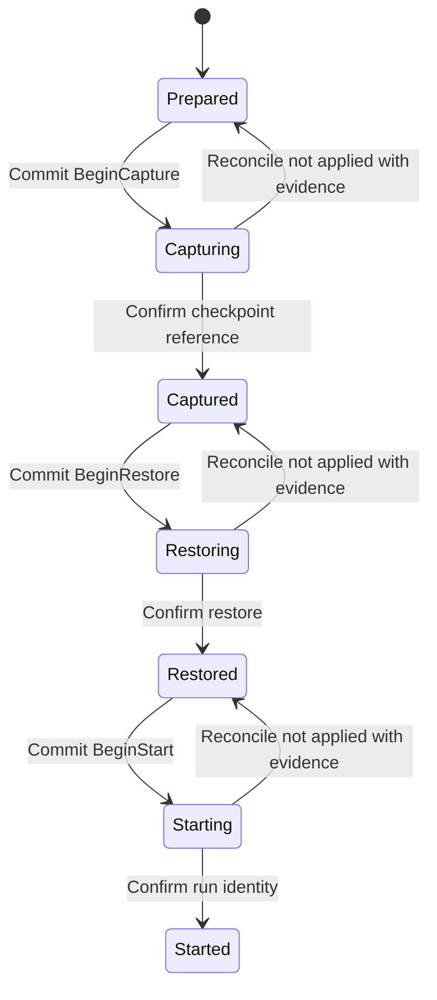

Reload the handoff receipt after an error before deciding whether an external action may run again.

For example, your launch callback starts the destination command, but saving Started fails. The receipt may remain Starting or the write may already have committed. Reload it and reconcile the actual destination run. Do not call the launch callback again merely because its acknowledgement was lost. A receipt records progress; the application still owns stopping the source, transferring bytes, verifying the checkpoint and starting the destination.

## Intent, callback and confirmation

A fresh successful Begin transition grants that caller permission to perform its action once. The helper commits Begin before invoking a callback and commits confirmation after success. Callback error/cancellation leaves an in-flight phase requiring reconciliation. A stale receipt loses compare-and-exchange: the store must atomically compare the expected revision and durably commit the new one. Reloading an in-flight phase is not a new permission to run its action.

ReconcileNotApplied requires the application to verify the old action cannot still complete and make partial effects safe, then supply an evidence reference. The SDK checks the reference is nonblank; it cannot validate that external claim. Confirmation transitions can record work discovered to have completed. Never reset uncertain work based only on a timeout or missing response.

## Durable storage and limits

Plans bind source sandbox, destination sandbox and complete intent to an operation ID. Reusing that ID with another plan is rejected. Checkpoint references and optional digests are stored, not fetched or checked against actual bytes. Do not put credentials in plans, callbacks' persisted results or evidence references.

The bundled FileReceiptStore is Unix-only and uses a local application-owned directory, atomic replacement, locks and fsync. It is not cross-host coordination or a promise about network filesystems. New directories/files use private modes; existing directory permissions are not changed. Reads and writes have a configurable one-MiB default limit. A cancelled blocking store operation may still finish; load also synchronizes an existing receipt before exposing it. For distributed controllers implement the ReceiptStore contract with suitable atomic durable storage.

## Model coverage

The model represents one Begin/action boundary with two callers holding the same old revision. It checks only one wins the compare-and-exchange and that callback action follows committed intent. Controls remove revision comparison and allow action without Begin. It does not prove disk durability, application reconciliation evidence, the seven-phase receipt schema, callback idempotency or source-process safety. The [handoff API guide](../handoff.md) contains full usage examples.
