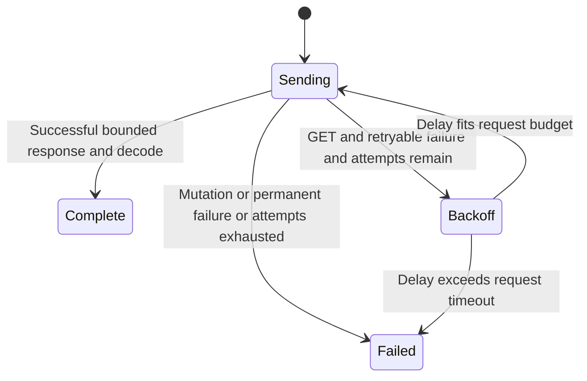

After a failed mutation, reconcile its remote effect before deciding whether to send it again.

For example, a create request can reach Boat before the client loses its reply. The client sends mutations only once automatically. An idempotency key supplied to an endpoint can help the server recognize retries, but it does not enable the HTTP retry loop. By contrast, a transient GET failure may retry within the configured attempt count.

## What retries actually do

Retry safety is derived from the actual HTTP method, so an endpoint cannot opt a mutation into retries with a flag. Default backoff starts at 200 ms, doubles and adds jitter within a 30-second local cap. A valid Retry-After can be longer; the client uses the greater server/local delay. If that delay exceeds configured request timeout, it returns the error rather than shortening the server delay. JSON decoding happens after successful body delivery and is not retried as a new HTTP attempt.

Cancellation drops local work, including a retry sleep or in-flight request. It does not undo a delivered mutation. The full wait helpers wrap retries and sleeps in a common deadline; a standalone request sequence is not a single global request-timeout budget.

## Model coverage

The model chooses GET or POST, up to three total attempts, and a transient/nontransient result. It checks mutation delivery happens once and the attempt cap is enforced. Controls opt POST into retries and permit a fourth GET attempt. Backoff arithmetic, Retry-After dates, response byte limits, actual network delivery and server idempotency are source/test contracts outside this finite model.
