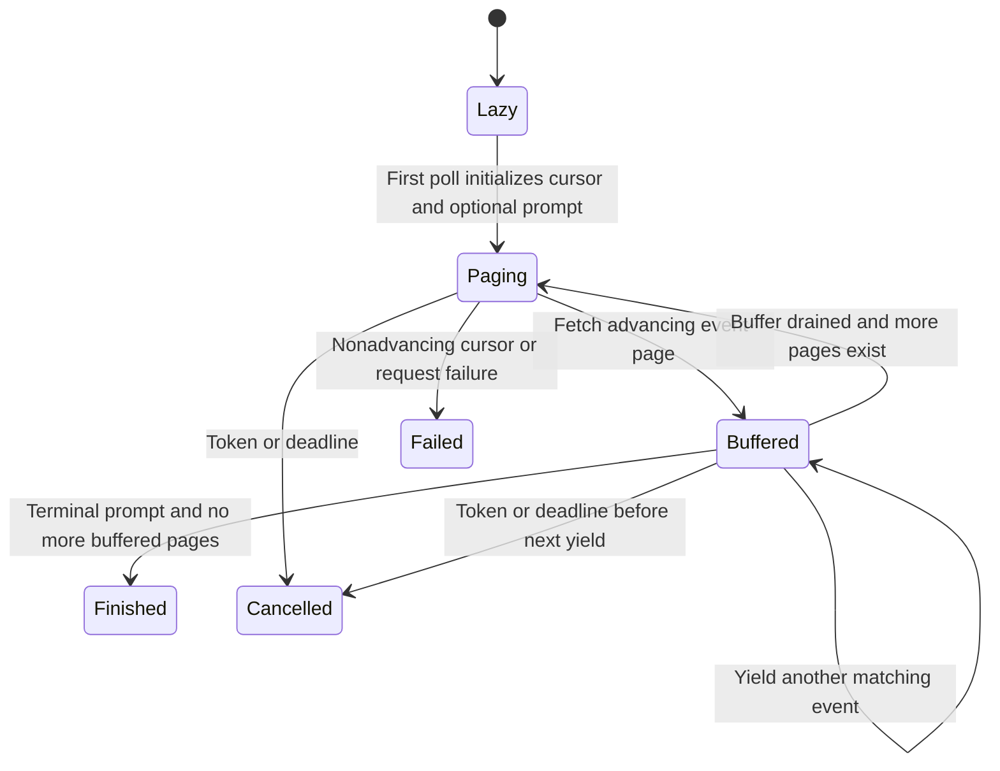

Poll the stream to start work, and distinguish local cancellation from stopping an accepted prompt.

Creating a stream object sends nothing. On its first poll, a prompt stream finds the current event cursor and submits exactly one prompt. Later pages are filtered to that returned prompt ID. If the caller cancels after submission, the prompt may still run remotely; dropping or cancelling this stream is not a prompt interrupt command.

## Pagination and completion

General event streams omit old history by default using the latest event cursor; include_existing changes that choice. Pages request ascending order. A nonempty page or has-more flag must produce a nonempty cursor different from the prior cursor; otherwise the stream errors instead of spinning. The fallback cursor requires a finite timestamp and nonempty event ID.

Prompt streams keep draining pages even after a terminal event is observed. If status polling first reports finished/failed, the stream refreshes once and drains the returned pages before ending because event persistence can lag status. This is not a guarantee that the backend will never publish an even later event. General event streams have no prompt terminal condition and keep polling until cancellation, timeout or error.

Cancellation/deadline checks happen even while draining an already buffered page, before yielding the next event. A cancellation token can interrupt in-flight I/O. A response-size limit bounds each buffered HTTP response; the model does not establish a whole-history memory bound.

## Model coverage

Two finite event pages and two buffered events explore termination while events/pages remain. The model checks that terminal knowledge alone cannot end the stream before the buffer and known pages drain. Controls remove those two independent completion guards. It abstracts cursor construction, prompt identity filtering, initial submission, status-refresh races and wall-clock deadlines; those require the actual Rust stream tests.
