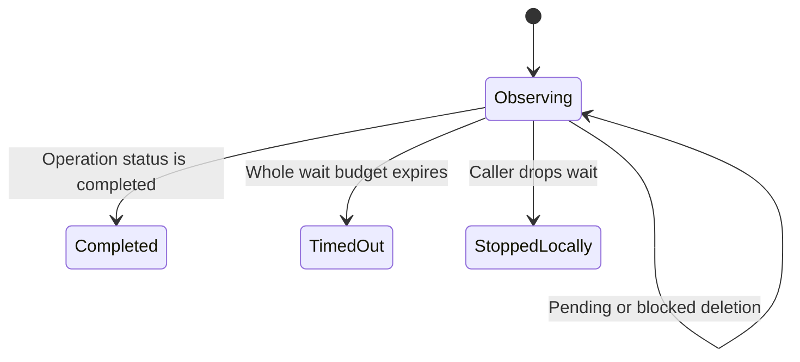

A wait stops observing when its budget ends; the remote operation can continue.

Suppose deletion returned an operation ID, then the sandbox vanished from ordinary listing. Keep the deletion ID and poll that operation. Only status `completed` ends the deletion helper successfully. `blocked`, `pending`, unknown noncompleted status and hidden sandbox visibility do not establish cleanup. A five-minute timeout is the caller's default observation budget, not a backend completion promise.

## Which result finishes which wait

| Helper   | Success or terminal rule                                                     |
| -------- | ---------------------------------------------------------------------------- |
| Ready    | Sandbox state is operable; terminal-failure states return an error           |
| Idle     | State is exactly Idle; terminal-failure states return an error               |
| Prompt   | Returns a terminal run for either finished or failed; caller inspects status |
| Desktop  | Nonempty desktop URL and provisioning is not true                            |
| Deletion | Only operation status completed                                              |

A nonzero timeout bounds HTTP attempts, retry sleeps and poll sleeps together. Budget checks occur before and after each awaited operation. Zero disables this deadline. Dropping the wait stops local polling, not the server's work. Desktop polling repeatedly calls its desktop endpoint and can carry the explicit public-access request; do not confuse it with a pure local readiness flag.

## Model coverage

The deletion model varies operation status and sandbox visibility independently. Completion captures the actual accepted status and requires completed. Its negative control treats blocked as success. HTTP errors/deadlines and other readiness predicates are documented source contracts, not modeled clock or service-progress guarantees.
